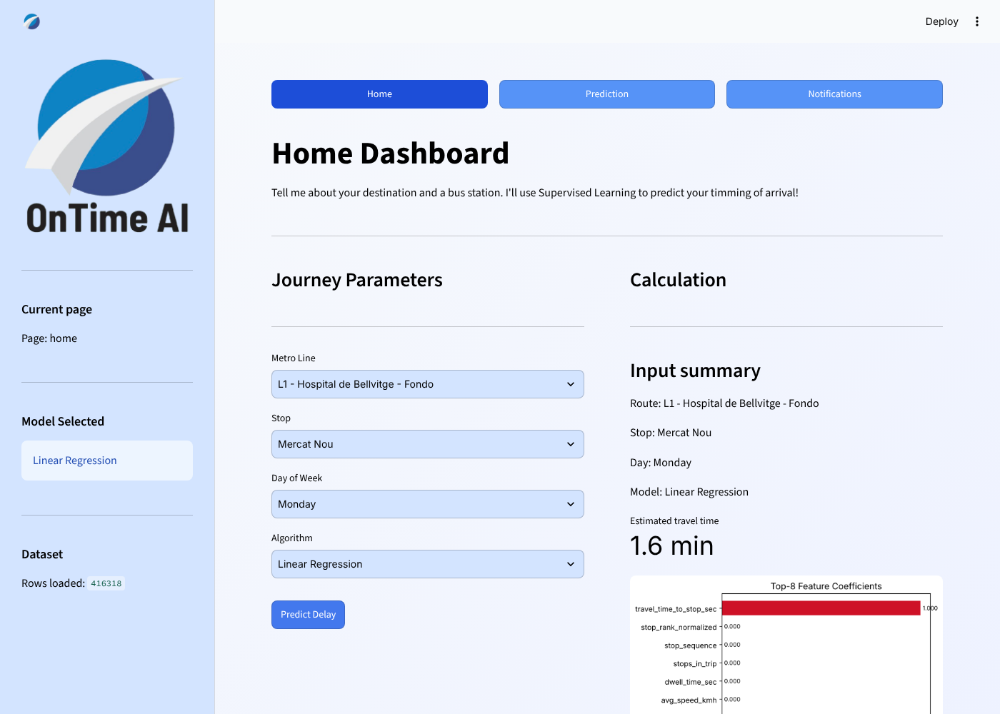

# OnTime AI 🚇

A Streamlit app that estimates travel times on the Barcelona metro using supervised machine learning.

Team project for the **Machine Learning** course, Bachelor in Artificial Intelligence & Data Science, La Salle – Universitat Ramon Llull (2026).

  



## What it does

Commuters often don't know how long a trip will take. OnTime AI lets you pick a **metro line**, a **stop** and a **model**, and returns an estimated travel time to that stop, together with a chart showing which factors weigh most in the prediction.

## How it works

1. **Data:** about 416,000 stop-level records built from TMB (Barcelona metro) schedule data in GTFS format.
2. **Cleaning and features:** missing values are filled, time of day is encoded, and each route is rebuilt as an ordered list of stops.
3. **Models (scikit-learn):** two regressors trained on the same features so they can be compared:
   - Linear Regression
   - Random Forest Regressor
4. **Evaluation:** 3-fold cross-validation, reporting the Mean Absolute Error in minutes.
5. **Interface:** a multi-page Streamlit dashboard with feature importance and coefficient charts.

## My contribution

I built the machine learning model and coordinated the team.

## Team

Júlia Escoriza · Sandra de Olano · Sara Gibert · Oriol Pros

## Run it locally

```bash
pip install -r requirements.txt
streamlit run app_ml.py
```

The dataset is included compressed (`Files/transport_dataset.csv.gz`) and loads automatically.

## Project structure

```
app_ml.py            Entry point: page setup, styles and navigation
Logic/utils_ml.py    Data loading, cleaning, route building and models
Navegation/          Streamlit pages (home dashboard; two pages reserved for future features)
Files/               Compressed dataset and the original app mockup
Img/                 Logo assets
```

## What I'd improve next

- The near-zero error comes from data leakage: the target (`travel_time_to_stop_sec`) is also in the input feature list, so the model can simply copy it, as the coefficient chart shows. A next version would remove it (and closely derived features such as average speed) and predict real delays from scheduled vs. observed times.
- Make the selected day of the week part of the model input.
